# Forecast-Driven Inventory Optimization

Turning probabilistic demand forecasts into inventory decisions, and measuring
whether the decisions actually get cheaper.

Most retail forecasting projects stop at an accuracy number. That number is not
the point. A forecast only has value if it changes a decision, and in a supply
chain the decision is *how much to order*. This project runs the whole chain
and reports what the decisions cost:

```
demand data  ->  quantile forecast  ->  inventory policy  ->  realised cost
```

**Headline result.** Over a 28-day holdout the newsvendor policy driven by
LightGBM quantile forecasts cut total inventory cost by **9.4%** against a
textbook reorder point, while *raising* the fill rate by **1.6 points**. That
is a Pareto improvement, not a trade, and it survives every stockout-cost
assumption tested (+3.9% to +21.6%).

**Data.** The [M5 / Walmart competition dataset](https://www.kaggle.com/competitions/m5-forecasting-accuracy):
3,049 SKUs in one store, 1,941 days of daily unit sales, with a calendar of
holidays and SNAP benefit days and a weekly shelf-price table.

---

## 1. Why quantiles, not point forecasts

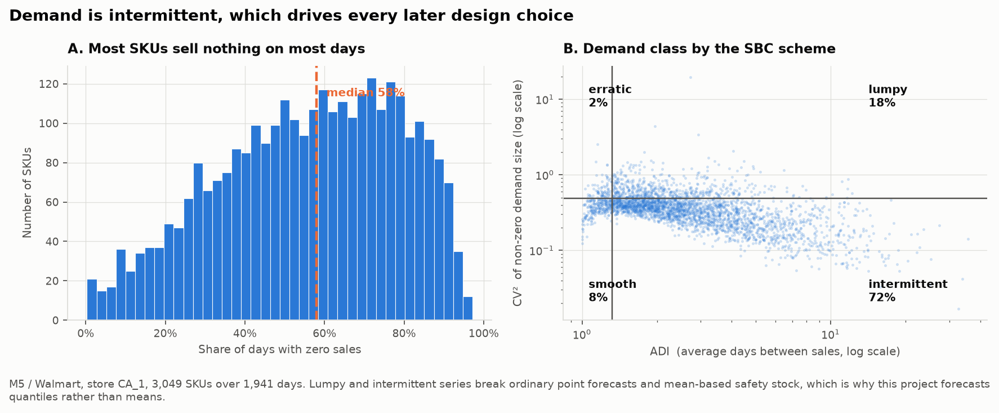

**90% of SKUs are intermittent or lumpy.** Demand is zero on 55% of SKU-days,
and the median SKU sells nothing on 58% of days.

| Class | Share | Meaning |
|---|---|---|
| Intermittent | 72.0% | Sells rarely, in consistent sizes |
| Lumpy | 17.9% | Sells rarely, in wildly varying sizes |
| Smooth | 7.6% | Sells regularly, predictably |
| Erratic | 2.5% | Sells regularly, in varying sizes |

For a series that sells nothing on 58% of days, the conditional mean is a
number that almost never occurs. Order the mean and you are stocked out
roughly half the time. What an inventory policy needs is a **quantile** of the
demand distribution, chosen from the economics of being short versus being
long. That is the newsvendor problem, and it is why the forecaster here is
trained on pinball loss rather than squared error.

## 2. What drives demand

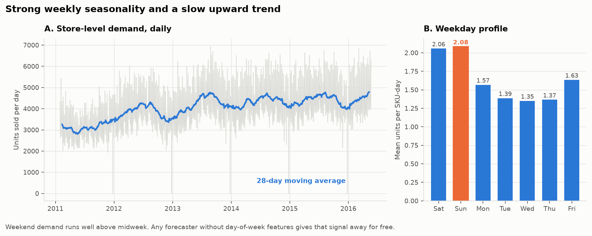

Weekly seasonality is strong: Sunday runs 54% above Wednesday, on a slow
upward trend.

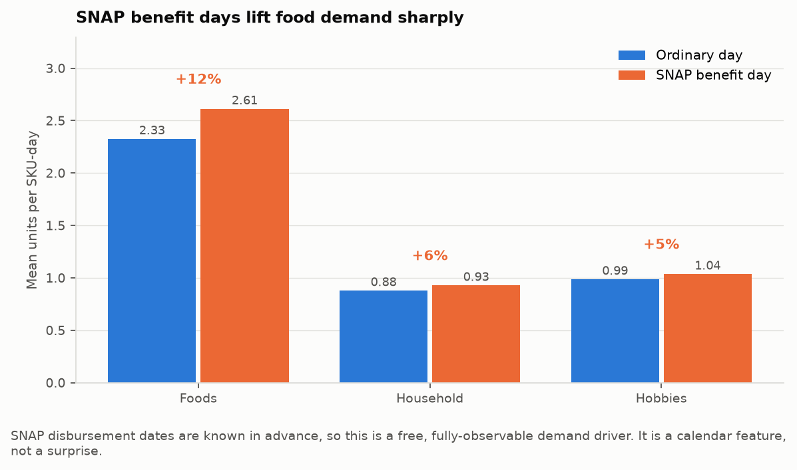

SNAP benefit days lift food demand **12.3%**. Disbursement dates are fixed and
published in advance, so this is a fully observable driver, not a shock.

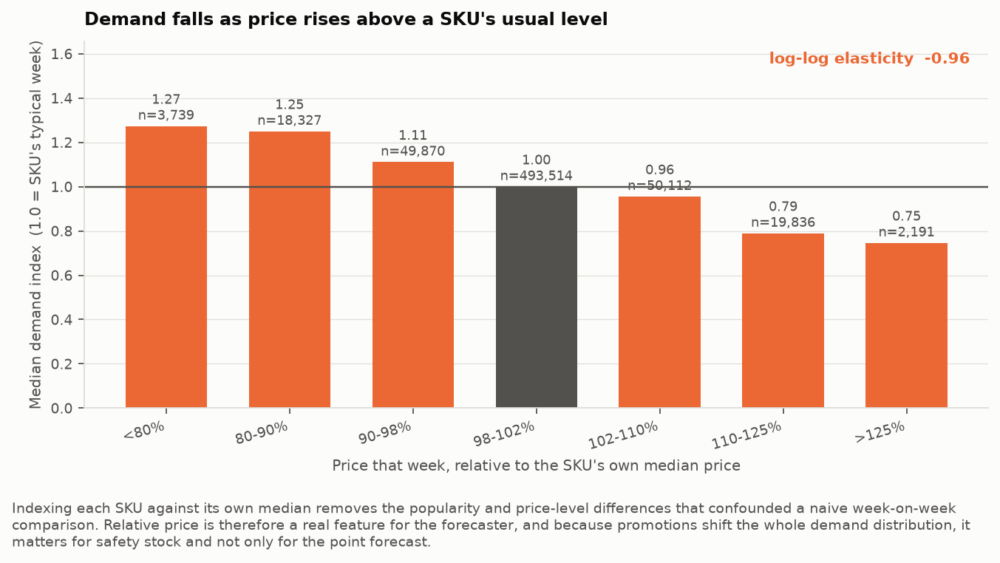

A clean monotonic demand curve, log-log elasticity **-0.96**, measured by
indexing each SKU against its own median price and median weekly volume.

> **The first version of this figure was wrong.** It compared week-on-week
> changes in price against week-on-week changes in units. M5 prices are
> sticky, so 99% of SKU-weeks fell into a single "no change" bucket, the few
> change weeks were dominated by trend and seasonality, and the estimate came
> out showing demand *rising* when prices rose. Indexing within SKU removes
> the between-SKU differences in popularity and price level the naive
> comparison was actually measuring.

## 3. The scoreboard

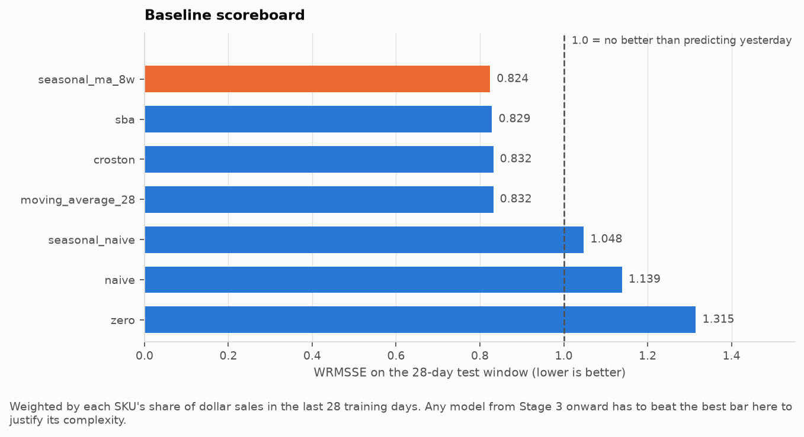

Seven baselines, each fitted only on data before its evaluation window.

| Baseline | Val WRMSSE | Test WRMSSE |
|---|---|---|
| Seasonal moving average (8w) | 0.8331 | 0.8243 |
| SBA | 0.8419 | 0.8288 |
| Croston | 0.8478 | 0.8319 |
| Moving average (28d) | 0.8352 | 0.8319 |
| Seasonal naive | 1.0717 | 1.0479 |
| Naive | 1.1182 | 1.1390 |
| Zero | 1.3275 | 1.3150 |

RMSSE below 1.0 means better than predicting yesterday's sales; the
denominator is each SKU's own in-sample naive error, which is what makes the
metric comparable across a SKU selling 200 units a day and one selling 0.3.

**Seasonal naive is worse than useless** (1.048): weekly seasonality is real
at the store level, but one week of history for one intermittent SKU is mostly
noise. **Zero is uncomfortably competitive**: its median RMSSE of 0.911 beats
seasonal naive's 0.938. On a typical SKU, predicting nothing beats predicting
last week's same weekday.

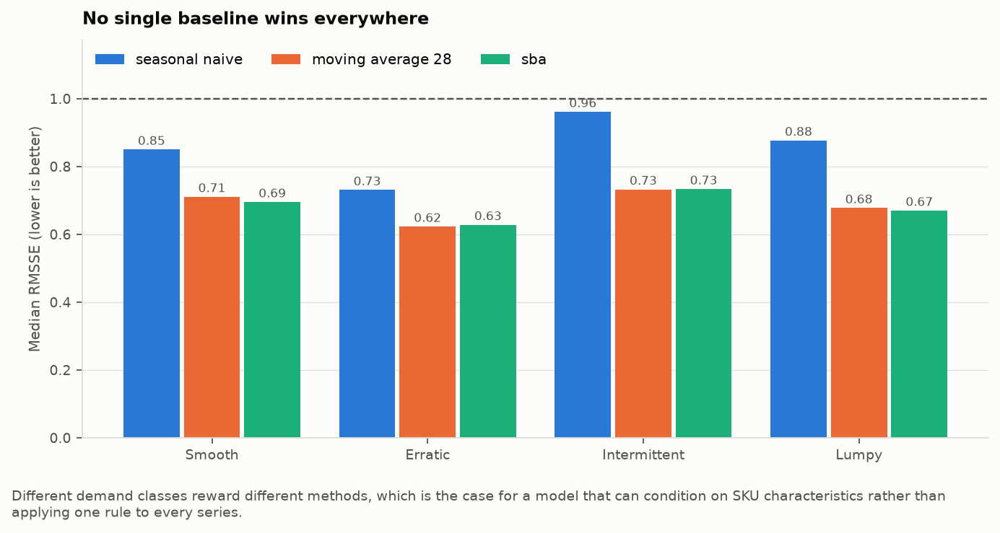

No single method wins everywhere, which is the argument for a model that can
condition on a SKU's characteristics.

## 4. The model

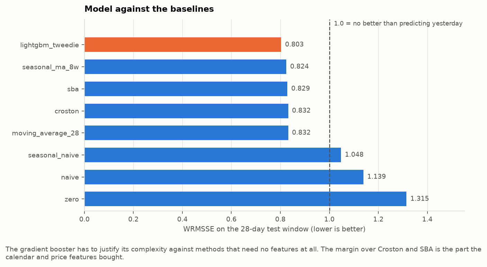

LightGBM with a Tweedie objective reaches **0.8076**, beating every baseline
and every demand class. The margin over the best baseline is **+2.0%**, which
is modest, and the feature importances explain why:

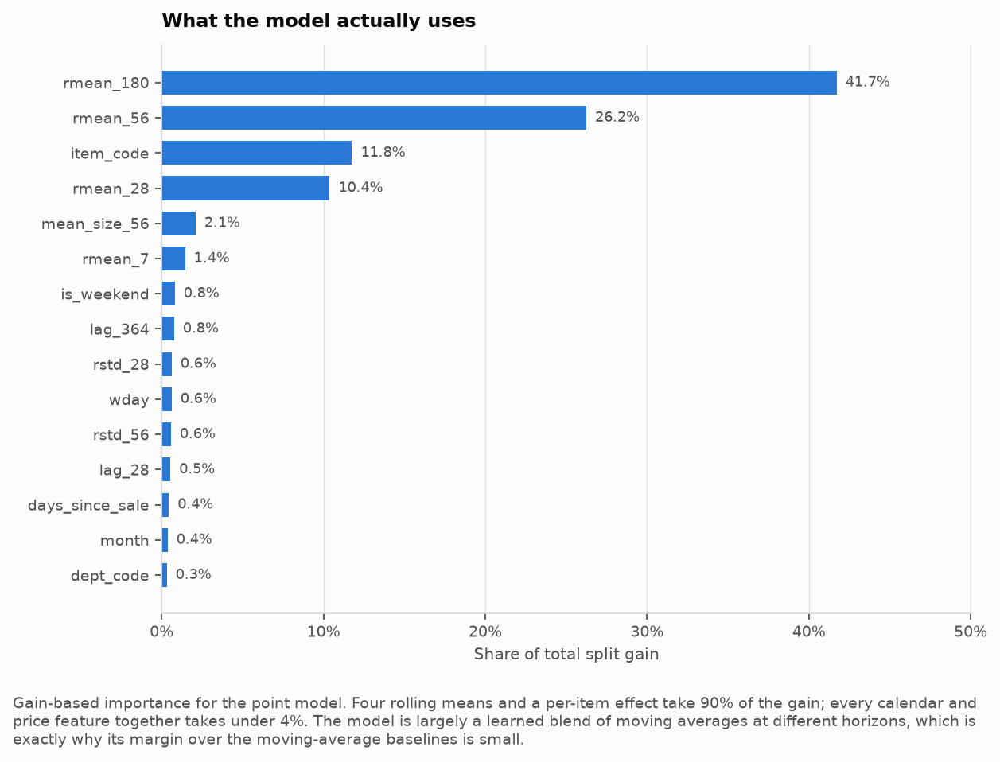

Four rolling means and a per-item effect take 90% of the gain; every calendar
and price feature together takes under 4%. The model is largely a learned
blend of moving averages at different horizons. Reporting that honestly
matters more than the +2.0% does.

**The quantiles are where the real gain is**, and they are what the inventory
model consumes:

| Quantile | Model pinball | Baseline pinball | Improvement |
|---|---|---|---|
| 0.50 | 0.5471 | 0.5546 | +1.4% |
| 0.75 | 0.5403 | 0.5665 | +4.6% |
| 0.90 | 0.3595 | 0.3999 | +10.1% |
| 0.95 | 0.2404 | 0.2700 | +11.0% |
| 0.975 | 0.1548 | 0.1857 | +16.6% |
| 0.99 | 0.0803 | 0.1206 | **+33.4%** |

The improvement grows with the quantile. The upper tail is exactly where
safety stock lives, so the part the model is best at is the part the decision
depends on.

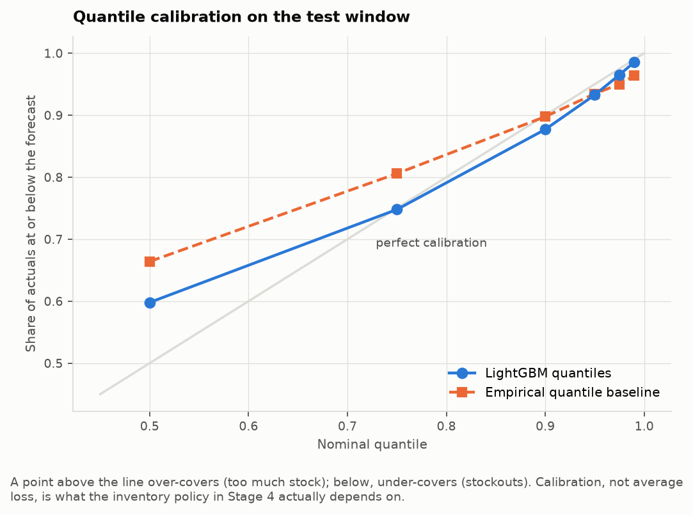

## 5. From forecast to order

The newsvendor result: order the quantile of demand equal to the critical
ratio,

$$Q^* = F^{-1}\left(\frac{C_u}{C_u + C_o}\right)$$

where `Cu` is the cost of being one unit short and `Co` of being one unit
long. Three policies, same realised demand, same opening stock, same costs:

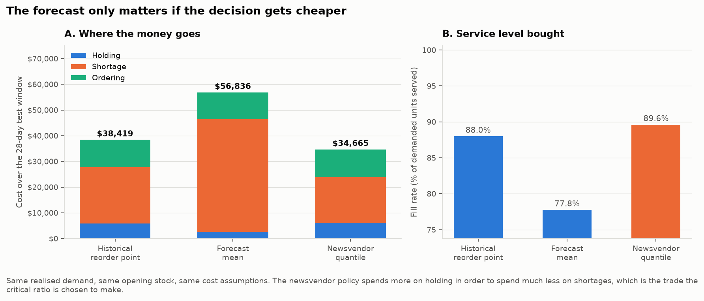

| Policy | Total cost | Holding | Shortage | Fill rate |
|---|---|---|---|---|
| Historical reorder point | $38,419 | $5,808 | $21,953 | 88.00% |
| Forecast mean | $57,304 | $2,610 | $44,258 | 77.54% |
| **Newsvendor quantile** | **$34,808** | $6,155 | $17,953 | **89.57%** |

The newsvendor policy spends *more* on holding in order to spend much less on
shortages. That is the trade the critical ratio exists to make. Ordering the
forecast mean is the worst of all three, which is the clearest possible
demonstration that a point forecast alone is not an inventory policy.

> **A bug worth recording.** The first cost model had holding cost purely
> proportional to price. Since shortage cost is too, price cancelled in the
> critical ratio and all 3,049 SKUs came out at exactly 0.9895 -- the per-SKU
> newsvendor was silently one global quantile. Adding a flat shelf-space cost
> per unit fixes it and encodes something true: a cheap bulky item occupies
> the same rack as an expensive one, so it is costlier to hold per dollar of
> value and should be allowed to stock out more often. Critical ratios now
> span 0.689 to 0.987 and five different quantile levels get selected.

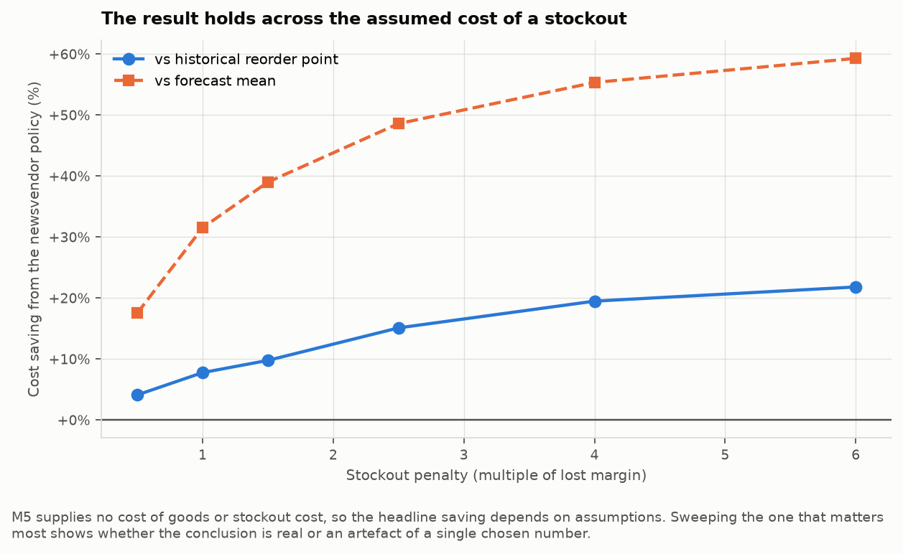

M5 supplies no cost of goods and no stockout cost, so the headline number
depends on assumptions. Sweeping the one that matters most, the saving ranges
from +3.9% to +21.6% and never turns negative.

## 6. When SKUs compete for space

Everything above treats each SKU independently, which is correct only while
the warehouse has room for whatever every SKU independently asks for. Once a
shared constraint binds, the right answer for one SKU depends on the others.
That is the capacitated lot-sizing problem, solved here with CP-SAT:

$$\min \sum_i \sum_t \left[ h_i I_{it} + p_i s_{it} + K y_{it} \right]$$

subject to inventory balance, a shared capacity limit per period, and
setup-forcing binaries that charge `K` once per order line.

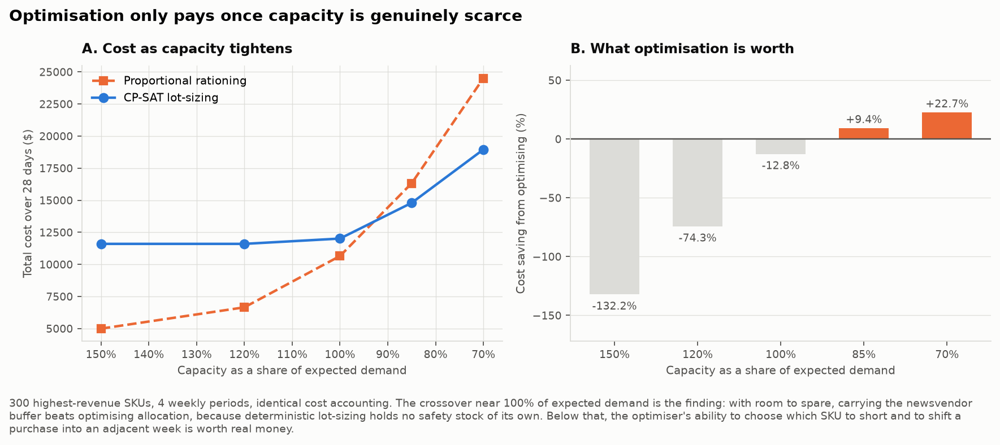

| Capacity | Rationing | CP-SAT | Saving |
|---|---|---|---|
| 150% of expected demand | $5,127 | $11,710 | -128.4% |
| 120% | $6,651 | $11,710 | -76.1% |
| 100% | $10,614 | $12,087 | -13.9% |
| 85% | $16,169 | $14,750 | **+8.8%** |
| 70% | $24,312 | $18,963 | **+22.0%** |

**The crossover is the finding.** With room to spare, carrying the newsvendor
buffer beats optimising allocation, because deterministic lot-sizing holds no
safety stock of its own: hand a solver the conditional mean and it plans to
meet the mean exactly, then misses whenever reality comes in above it. Below
roughly 100% of expected demand the constraint starts to bite, and the
optimiser's ability to choose *which* SKU to short and to shift a purchase
into an adjacent week is worth up to 22%.

> **Two earlier formulations failed, both instructively.** First, capacity was
> anchored to the newsvendor ask rather than to expected demand; since the ask
> is 2.16x expected, "70% capacity" was really 150% of what was needed and
> nothing was ever scarce. Second, the optimiser was handed the quantile plan
> as its demand. That was worse, for a deeper reason: shortage cost is linear
> in the model, so charging `p` per unit short of an inflated target makes the
> last unit of safety stock look as valuable as the first. The problem
> collapses into a knapsack, the solver fills expensive SKUs to their inflated
> target and zeroes cheap ones entirely, and uniform rationing beat it badly.

---

## Project structure

```
src/
  config.py      scope, horizon, cost structure, quantile levels
  data.py        M5 wide -> tidy panel and matrix views, time splits
  features.py    lag, rolling, calendar and price features (min lag = horizon)
  metrics.py     RMSSE, WRMSSE, pinball loss, coverage, bias
  baselines.py   naive, seasonal naive, moving averages, Croston, SBA
  models.py      LightGBM point (Tweedie) and quantile models
  inventory.py   cost model, newsvendor, order-up-to policies, simulator
  lotsizing.py   CP-SAT capacitated lot-sizing, rationing heuristic
  viz.py         shared plotting style (CVD-validated palette)
scripts/
  download_data.py   fetch and extract the M5 archive
  run_eda.py         figures 1-4, intermittency profiling
  run_baselines.py   figures 5-6, the scoreboard
  run_forecast.py    figures 7-9, trains models, saves forecasts
  run_inventory.py   figures 10-11, policy comparison and sensitivity
  run_lotsizing.py   figure 12, capacity sweep
tests/              93 tests
```

## Reproducing

```bash
pip install -r requirements.txt
python scripts/download_data.py     # ~50 MB
python scripts/run_eda.py           # ~30s
python scripts/run_baselines.py     # ~10s
python scripts/run_forecast.py      # ~5 min, trains 7 models
python scripts/run_inventory.py     # ~10s
python scripts/run_lotsizing.py     # ~3 min, 5 CP-SAT solves
pytest -q                           # 93 tests
```

Scope lives in `src/config.py`. `STORE_ID` defaults to `CA_1`; the pipeline is
store-agnostic and the full 30,490-series dataset changes only the row count.

## Methodology

**The split is by time, never at random.** Train ends at day 1885, validation
covers 1886 to 1913, test is the final 28 days. A random split on time series
leaks the future into training and produces scores that evaporate out of
sample.

**Every sales-derived feature is lagged by at least 28 days**, the length of
the horizon. A feature built from yesterday's sales cannot be computed for day
origin+20 at the moment the forecast is made. With a minimum lag equal to the
horizon, one model forecasts all 28 days directly, with no recursion.
`tests/test_features.py` asserts this by corrupting all data after the origin
and checking that no feature inside the horizon moves, and includes a control
proving that test can fail.

**Pre-launch zeros are removed.** M5 encodes "not stocked yet" as a missing
price. Left in, a SKU launched on day 800 looks like it had 799 days of zero
demand.

**Unmet demand is lost, not backordered**, which is the right model for
grocery retail: the customer buys another brand and does not come back for
that unit.

## Limitations

- **Costs are assumed.** M5 has no cost of goods, warehousing rate or stockout
  cost. The sensitivity sweep is what makes the conclusion robust, not the
  point estimate.
- **The square-root-of-time rule** scaling daily safety stock to the
  protection interval assumes demand is independent across days. Real demand
  is positively autocorrelated, so this under-provisions slightly.
- **The lot-sizing model is deterministic.** It plans against a point forecast
  and holds no safety stock of its own, which is exactly why it loses at slack
  capacity. A stochastic or robust formulation would fix this and is the
  natural next step.
- **One store.** The method is store-agnostic; the numbers are not.
- **No retrain on validation.** Models are trained before the validation
  window and used on test without refitting, a conservative choice that
  slightly understates achievable accuracy.

## References

Makridakis, S., Spiliotis, E., & Assimakopoulos, V. (2022). The M5 competition:
Background, organization, and implementation. *International Journal of
Forecasting*, 38(4), 1325-1336.

Syntetos, A. A., Boylan, J. E., & Croston, J. D. (2005). On the categorization
of demand patterns. *Journal of the Operational Research Society*, 56(5), 495-503.

Syntetos, A. A., & Boylan, J. E. (2005). The accuracy of intermittent demand
estimates. *International Journal of Forecasting*, 21(2), 303-314.

Croston, J. D. (1972). Forecasting and stock control for intermittent demands.
*Operational Research Quarterly*, 23(3), 289-303.

Karimi, B., Fatemi Ghomi, S. M. T., & Wilson, J. M. (2003). The capacitated
lot sizing problem: a review of models and algorithms. *Omega*, 31(5), 365-378.
